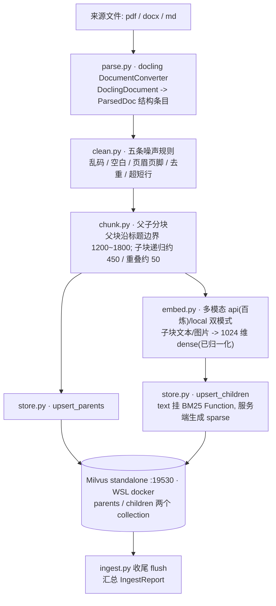
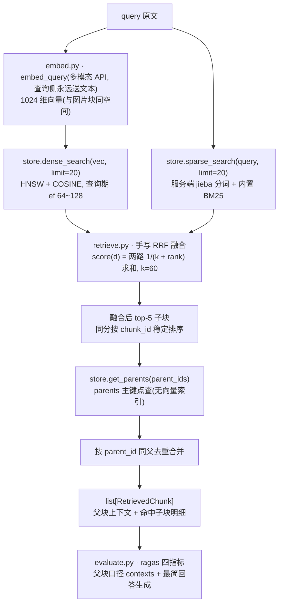

# 00.2-契约与数据流

> 一句话: 入库 / 检索两条端到端链路图、facade 三入口、`contracts.py` 六类型流向与 `RAG2_` 配置出口。
> 体系: rag_0.1 · 模块 00 总览 · 契约与数据流
> 上游: [00.1-目标与决策](./00.1-目标与决策.md)
> 下游: [00.3-实现要点](./00.3-实现要点.md)
> 细节见: [模块索引](./README.md)

## 三、数据流与接口契约

### 3.1 端到端数据流

**入库链路(ingest = parse → clean → chunk → embed → store)**:



**检索链路(search = 双路 top-20 → 手写 RRF k=60 → top-5 → 父块回溯去重)**:



两条边界的错误语义([05.3-实现要点](./05.3-实现要点.md) §4.3): 两路皆空时 `search` 返回 `[]`(确无相关内容); Milvus 连接类故障向上抛异常, 不吞。

### 3.2 对外接口: 包级 facade 只暴露三个入口

```python
ingest(paths: list[str | Path]) -> IngestReport
search(query: str, top_k: int = 5) -> list[RetrievedChunk]
evaluate(testset_path: str | None = None, report_dir: str = "./eval_reports") -> EvalReport
```

管理类操作(按 `doc_id` 删除、列文档)不进 facade, 由 `store.py` 直供、`cli.py` 直调([07.1-目标与决策](./07.1-目标与决策.md) §2.1)。

### 3.3 contracts.py 六类型与流向

| 契约类型 | 产出于 | 主要消费方 |
|---|---|---|
| `ParsedDoc` | 02 parse + clean | 03 chunk |
| `ParentChunk` / `ChildChunk` | 03 chunk | 04 embed / store |
| `RetrievedChunk` | 05 retrieve(经 facade `search`) | 06 evaluate; 模块 07移植期的适配层 |
| `IngestReport` | 模块 07 `ingest.py`(编排 02→03→04) | `cli.py`、人工排查 |
| `EvalReport` | 06 evaluate | `cli.py`、移植决策 |

字段细节以各分篇与落地时的 `contracts.py` 为准; 九字段元信息(`chunk_id, parent_id, doc_id, source, page_no, heading_path, chunk_type(text|table|image), char_len, created_at`)命名固定, 不得增删改名, 父块同样携带(其 `parent_id` 为空)。`Hit` / `ParentRow` 等模块内部结构不进 `contracts.py`([04.2-契约与数据流](./04.2-契约与数据流.md) §3.2)。

### 3.4 配置出口

全部配置只读 `RAG2_` 前缀环境变量, 由 `config.py` 统一读取, **不依赖 `settings/config.py`**: 基础表(Milvus 地址、embedding 双模式(`RAG2_EMBED_MODE` 默认 api, 百炼多模态 `qwen3-vl-embedding`; local 纯文本离线备选)、judge 三件套、分块与检索参数)见 [模块 01](README.md) §三; 各分篇补充项——`RAG2_EMBED_DIM`(本期固定 1024) / `RAG2_EMBED_BATCH`(单请求内容元素总数上限) / `RAG2_EMBED_IMG_BATCH`(图片分批上限) / `RAG2_HNSW_EF`(模块 04), `RAG2_DO_OCR` / `RAG2_IMAGE_DESC` / `RAG2_IMAGE_DIR` / `RAG2_IMAGE_FORMAT` / `RAG2_SHORT_LINE_MAX` / `RAG2_HF_GEOMETRIC`(模块 02)。另有两个"环境级出口": Milvus 的 19530 端口与 `.env` 的 RAG2_ 段——移植时随目录一起带走。
